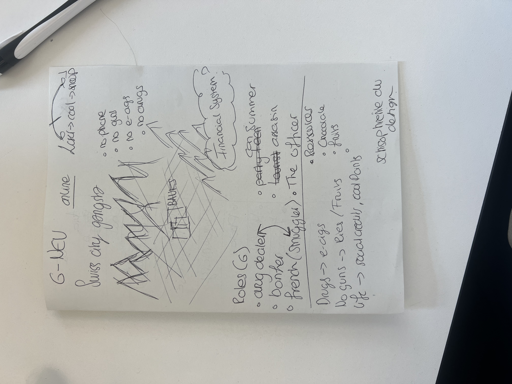
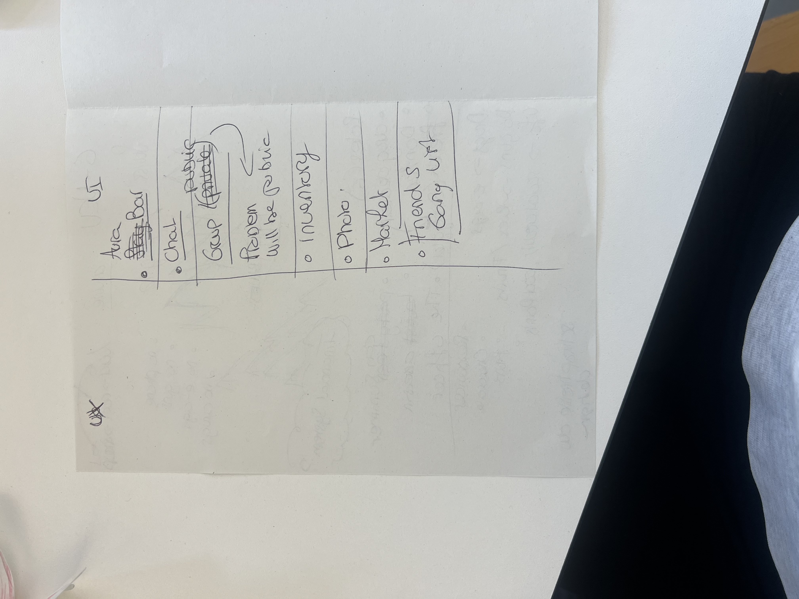
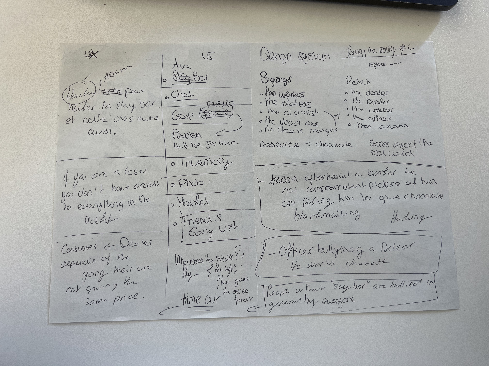
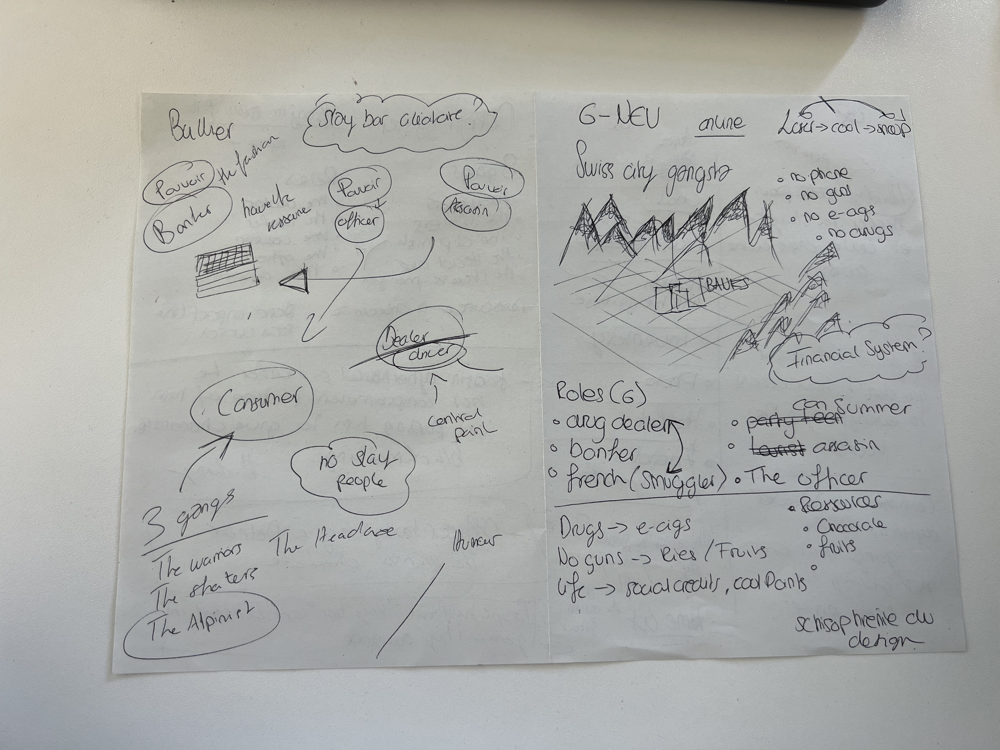

# Notes — A virtual world for cyberbullying

We have to work with canvas expectations nowadays.

## Brief
Today we're going to create a virtual world and understand what kind of bullying can be found there.

- We want to challenge it by creating a universe with certain conditions allowing for cyberbullying.
- We are going to find out what it means for design to program features and agency.
- What type of bullying could happen in this world?
- Give us all the tools to understand the responsibilities we have as designers.
- **Technology is never neutral.**
- This virtual world can touch our kids and teenagers: it can appeal to them, cynically.
- We want to bring hope, coming from a good place.

## References
- Solarpunk
- GTA
- Swiss gangsta game: G-NEV, *Swiss City Gangsta*
- *The Warriors* (1979)

## Rules
- What can the system be used for as bullying?
- What will impact the real world?
- Go back through the game.

## Mechanics of harassment
- Permanent comparison, anxiety, self-esteem that depends on the "slay bar"
- *Movie Star Planet*
- Loss of self-confidence
- Everybody plays, so you feel obliged to play: a form of harassment, you want to be part of the group
- You became the target in real life because you started later than the others — maybe your parents didn't allow you to have a phone
- Parental limitations
- Exclusion
- Frustration

## Feelings
- Loneliness, loss of confidence
- Fear, feeling trapped by the hacker
- Loss of control over one's image, destroyed reputation
- Betrayal, humiliation, mistrust of everyone
- Feeling that nobody can help, silence
- Dependence, having to obey in order to be protected
