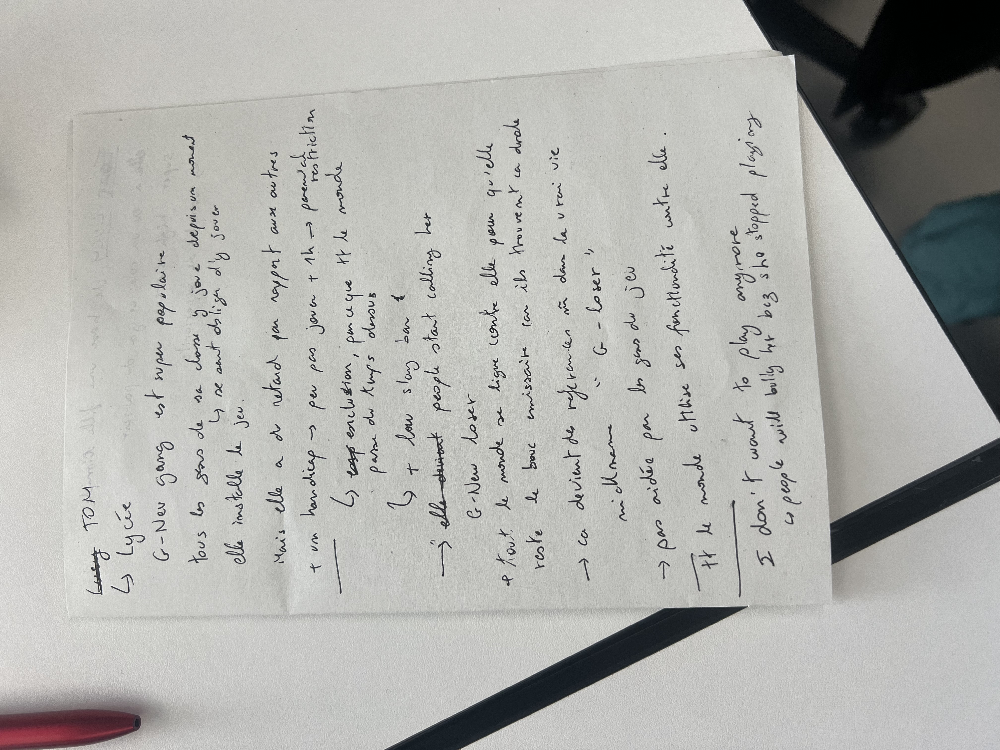
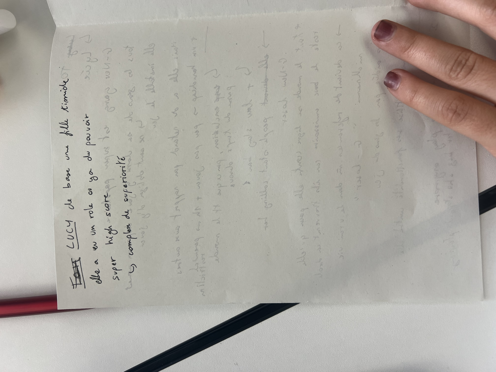
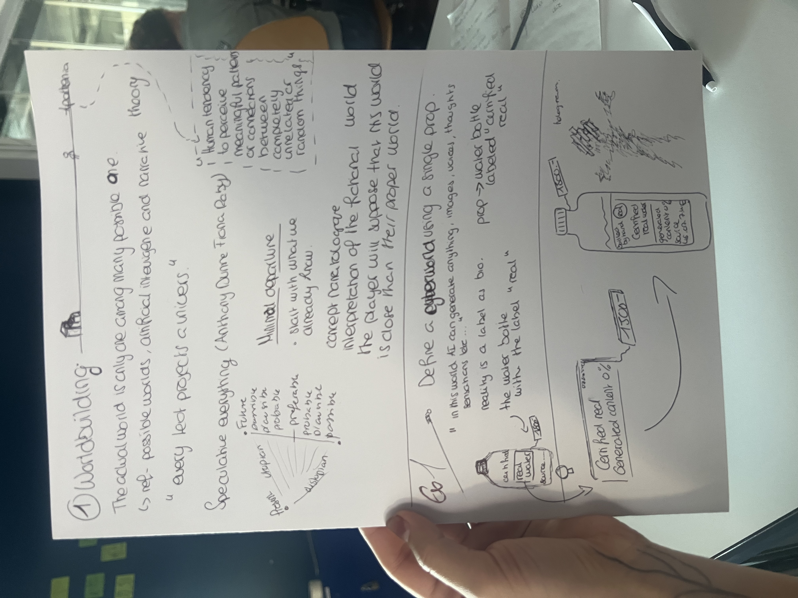
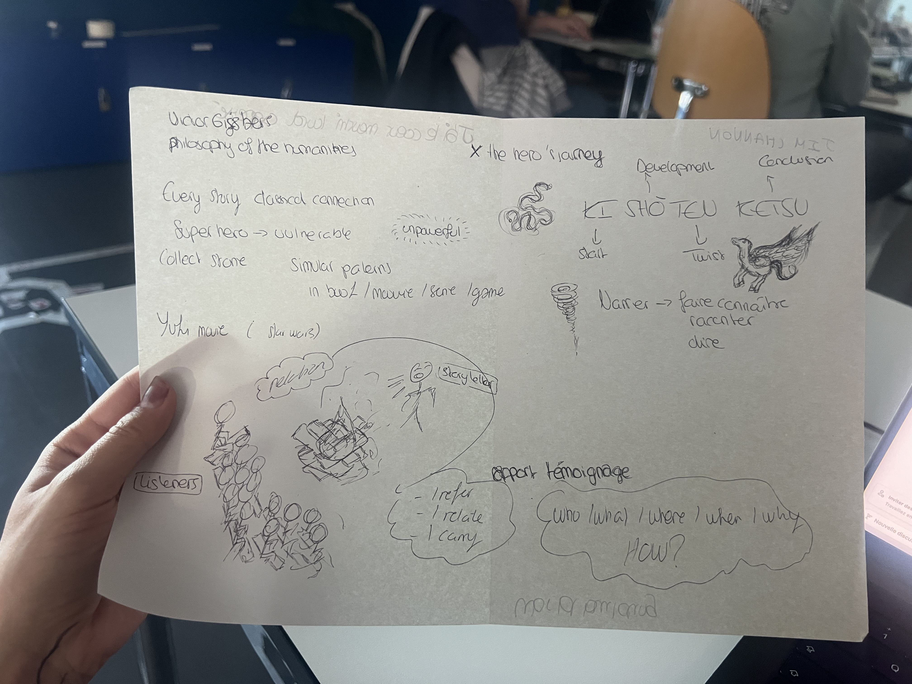

# 12.10.2026

what are the consequences of it what can we do 

## Summary

Story frameworks can reveal recurring patterns, but they should not be treated as recipes. Begin with the heart of the story: what a character wants, what stands in their way, and whose perspective the audience follows. Vladimir Propp’s study of folktales shows how stories can be analyzed through recurring roles and plot functions; Joseph Campbell’s archetypes offer another way to compare stories. Both approaches can be useful, but they can also flatten cultural differences if treated as universal formulas. For games and other interactive narratives, use structure to support the emotional core and the player’s experience—not to replace them.

*Star Wars* also shows how stories combine influences. One comparison is with Akira Kurosawa’s *The Hidden Fortress*: both give the audience a view of a larger conflict through lower-status characters—the peasants in Kurosawa’s film and the droids in *Star Wars*. That perspective can make the people on the edges of a conflict as compelling as its central heroes.

## Polished rewrite

When designing a game or another interactive story, it is easy to focus first on plot structure and familiar storytelling formulas. Those frameworks can help us recognize patterns, but they are not a substitute for the story’s emotional core. Start by asking what the character wants, what they struggle with, and how the audience—or player—experiences events through their perspective.

Vladimir Propp’s analysis of folktales is one useful example. By identifying recurring character roles and story functions, Propp showed that tales often share recognizable patterns. This can help game writers think about how events fit together, but a pattern is a tool for understanding a story, not a machine that automatically creates a meaningful one. Folktales also have complex histories: many were passed on, adapted, and collected rather than written by a single known author.

Joseph Campbell’s work on archetypes offers another lens for finding similarities among stories. These ideas can spark useful comparisons, but we should be cautious about treating one framework as a universal account of storytelling. Stories come from particular cultures and histories, and their differences matter as much as their shared motifs.

The relationship between *Star Wars* and Kurosawa’s *The Hidden Fortress* illustrates how a story can borrow and transform influences. Both involve a large conflict seen in part through less powerful, peripheral characters: peasants in Kurosawa’s film and droids in *Star Wars*. Their viewpoint gives the audience an unexpected way into the action. For interactive storytelling, the broader lesson is to choose structures and influences deliberately, while keeping character, perspective, and emotional meaning at the center.

**Women in Refrigerators** (often called **fridging**) is **a literary and comic book trope coined by writer Gail Simone in 1999**. [1]

- **The Definition**: It describes a storytelling pattern where female characters are killed, injured, traumatized, or depowered solely to serve as a plot device or emotional catalyst for a male character's arc. [1, 2]

**The Origin**: The term comes from *Green Lantern #54* (1994), written by Ron Marz, in which Kyle Rayner returns home to find his girlfriend, **Alexandra DeWitt**, murdered and stuffed inside a refrigerator by the villain Major Force. [1]

- **The Origin**: The term comes from *Green Lantern #54* (1994), written by Ron Marz, in which Kyle Rayner returns home to find his girlfriend, **Alexandra DeWitt**, murdered and stuffed inside a refrigerator by the villain Major Force. [1]

**The List & Impact**: Simone created a website and compiled a list of over 100 female comic book characters who suffered similar fates. This sparked a major, ongoing cultural debate about sexism, tropes, and the underrepresentation or objectification of women in pop culture and superhero media. [1, 2, 3]

- **The List & Impact**: Simone created a website and compiled a list of over 100 female comic book characters who suffered similar fates. This sparked a major, ongoing cultural debate about sexism, tropes, and the underrepresentation or objectification of women in pop culture and superhero media. [1, 2, 3]

## Summary — Worldbuilding and narrative

### Worldbuilding and speculative design

The real world is only one of many imaginable worlds. Speculative design can use possible futures—not just likely ones—to explore how things might be different. Each story or designed artifact implies a universe with its own assumptions and rules.

A useful approach is **minimal departure**: begin with what people already know, then introduce a small number of changes. Audiences tend to interpret an unfamiliar world in relation to their own. Even a single prop can communicate a world’s values and rules. The water-bottle example—labelled “certified real” and “0% generated content”—uses claims about authenticity and provenance to question how people decide what is real, especially when AI can generate images, voices, and other content. The notes also point to our tendency to find meaningful patterns or connections, even among unrelated things.

### Narrative structures and storytelling

Stories often reuse recognizable patterns across books, films, series, and games. A hero may be powerful yet vulnerable, and the **hero’s journey** is one familiar structure—but it is a framework, not a rule every story must follow. The notes also show **Kishōtenketsu**, a four-part structure: *ki* (introduction), *shō* (development), *ten* (twist), and *ketsu* (conclusion). It offers a way to shape a story without relying only on a conventional conflict-driven arc.

Storytelling is also communication between a storyteller and listeners. Useful questions for shaping a narrative include: **Who? What? Where? When? Why? How?**

**Achilles’ heel — a character’s strength and vulnerability**

In the familiar version of the Greek myth, Achilles’ mother, Thetis, dipped him in the River Styx to make him invulnerable, but she held him by one heel. That spot remained vulnerable. During the Trojan War, Paris’s arrow struck Achilles in the heel and killed him. (This detail is part of later tradition; Homer’s *Iliad* does not describe the heel story.)

As a storytelling example, Achilles is nearly invincible yet has one exposed weakness. The contrast makes him more vulnerable and creates tension. In a character, an “Achilles’ heel” can mean a specific weakness that complicates their strengths—not necessarily a literal flaw or the only contradiction they have.

contradition in a character 

a good character is an oxymore a foolish a fool bouffond pointed sharp keen  

manipulation

character name → Echo 

In Echo’s world, AI could generate almost anything images, voices, music, memories, even the sensation of warm sunlight on your skin. 

The rarest things carried a small label: real, made by a human

They cost more than gold.

Echo is a hologram/unreal cyber character

stasis vs change

<!-- 5 × image.png (not saved) -->

Hell’s paradise god no gender woman men 

hologram see that they are not completly real 

transformation

I want that character be a creation of AI and realizing the power luxury of human certified that is quite rare in this world where ai is everywhere 

the question of this character is → who Am I what is human how can we get it why can we not create it maybe he will try to find all the human last pieces as a tresor like we are searching gold in our wolrd this hero is trying finding the big tresor the human creation ( at the end they are a sort of human creation ?)

**Echo (teenager)**

**The world →** AI makes everything, images, voices, music, memories, even the feeling of sun on your skin. The rarest things have a small label, *real, made by a human*. They are worth more than gold.

**Echo →** a teenage hologram, made by AI, not a man and not a woman. You can see it is not fully real. It feels lost and doesn’t know who it is.

**Personality →** clumsy, caring, creative, funny, curious, scared easily, but loves adventure.

**Its quest →** like people looking for gold, Echo searches for the last things made by humans, the “big treasure.”

**Its main questions →** Who am I? What makes someone human? Why can’t AI make it?

<!-- image.png (not saved) -->

**Its contradiction →** an artificial being obsessed with what is real. It looks for something it can never be.

**Its weak point →** It wants the one thing that, by definition, leaves it out.

**Possible ending →** Echo finds out it is also, in a way, a human creation, humans made the AI that made Echo. The treasure it was looking for was partly inside itself.
