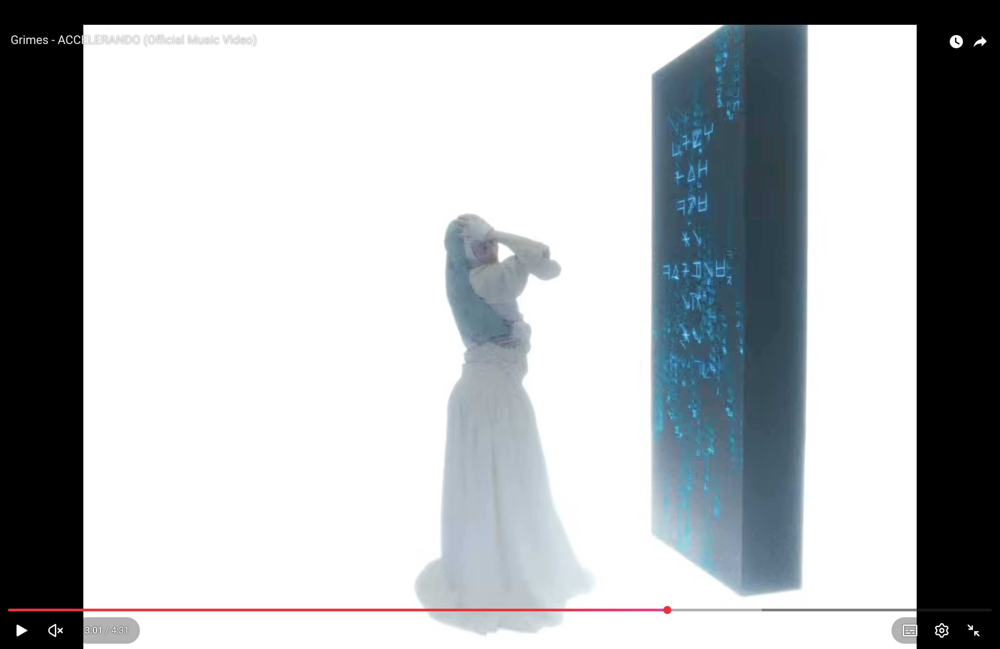
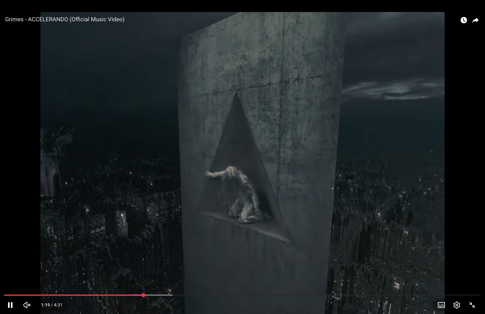

# Consequences, storytelling & worldbuilding

## Consequences
What are the consequences of it? What can we do?

 <!-- TODO: convert HEIC -->
 <!-- TODO -->

## Story frameworks
Story frameworks can reveal recurring patterns, but they should not be treated as recipes. Begin with the heart of the story: what a character wants, what stands in their way, and whose perspective the audience follows.

- **Vladimir Propp** studied folktales through recurring roles and plot functions. A pattern is a tool for understanding a story, not a machine that automatically creates a meaningful one. Folktales were also passed on, adapted and collected rather than written by a single author.
- **Joseph Campbell**'s archetypes offer another lens for comparing stories, but can flatten cultural differences if treated as universal formulas.
- For games and interactive narratives, use structure to support the emotional core and the player's experience, not to replace them.

*Star Wars* shows how stories combine influences. Compare it with Akira Kurosawa's *The Hidden Fortress*: both show a larger conflict through lower-status characters — the peasants in Kurosawa's film, the droids in *Star Wars*. That perspective makes the people on the edges of a conflict as compelling as the central heroes.

### Women in Refrigerators (fridging)
A trope named by writer Gail Simone in 1999: female characters are killed, injured, traumatized or depowered solely to serve as a plot device for a male character's arc.

- **Origin:** *Green Lantern* #54 (1994, Ron Marz): Kyle Rayner finds his girlfriend Alexandra DeWitt murdered and stuffed in a refrigerator by the villain Major Force.
- **Impact:** Simone compiled a list of 100+ female comic characters with similar fates, sparking a lasting debate on sexism and the objectification of women in pop culture.

 <!-- TODO -->
 <!-- TODO -->

## Worldbuilding and speculative design
The real world is only one of many imaginable worlds. Speculative design uses possible futures, not just likely ones, to explore how things might be different. Every story or designed artifact implies a universe with its own assumptions and rules.

- **Minimal departure:** begin with what people already know, then introduce a small number of changes. Audiences interpret an unfamiliar world in relation to their own.
- Even a single prop can communicate a world's values. Example: a water bottle labelled "certified real" and "0% generated content" questions how we decide what is real when AI can generate images, voices and more.
- We tend to find meaningful patterns even among unrelated things.

## Narrative structures
- **Hero's journey:** a familiar framework, not a rule.
- **Kishōtenketsu:** four parts — *ki* (introduction), *shō* (development), *ten* (twist), *ketsu* (conclusion). Shapes a story without relying on conflict.
- Storytelling is communication between storyteller and listeners: **Who? What? Where? When? Why? How?**

### Achilles' heel
Thetis dipped Achilles in the River Styx to make him invulnerable but held him by the heel; Paris's arrow struck that spot and killed him. (The heel detail is later tradition — not in Homer's *Iliad*.) A near-invincible hero with one exposed weakness: the contrast creates tension.

## Contradiction in a character
A good character is an oxymoron: a fool who is sharp, keen. Also: manipulation.

## Character idea: Echo
**The world →** AI makes everything: images, voices, music, memories, even the feeling of sun on your skin. The rarest things carry a small label, *real, made by a human*. They are worth more than gold.

**Echo →** a teenage hologram, made by AI, not a man and not a woman. You can see it is not fully real. It feels lost and doesn't know who it is.

**Personality →** clumsy, caring, creative, funny, curious, scared easily, but loves adventure.

**Its quest →** like people looking for gold, Echo searches for the last things made by humans: the "big treasure."

**Main questions →** Who am I? What makes someone human? Why can't AI make it?

**Contradiction →** an artificial being obsessed with what is real. It looks for something it can never be.

**Weak point →** it wants the one thing that, by definition, leaves it out.

**Possible ending →** Echo finds out it is also, in a way, a human creation: humans made the AI that made Echo. The treasure was partly inside itself.

Other notes: stasis vs change, transformation, "Hell's paradise", hologram that shows it is not completely real.
