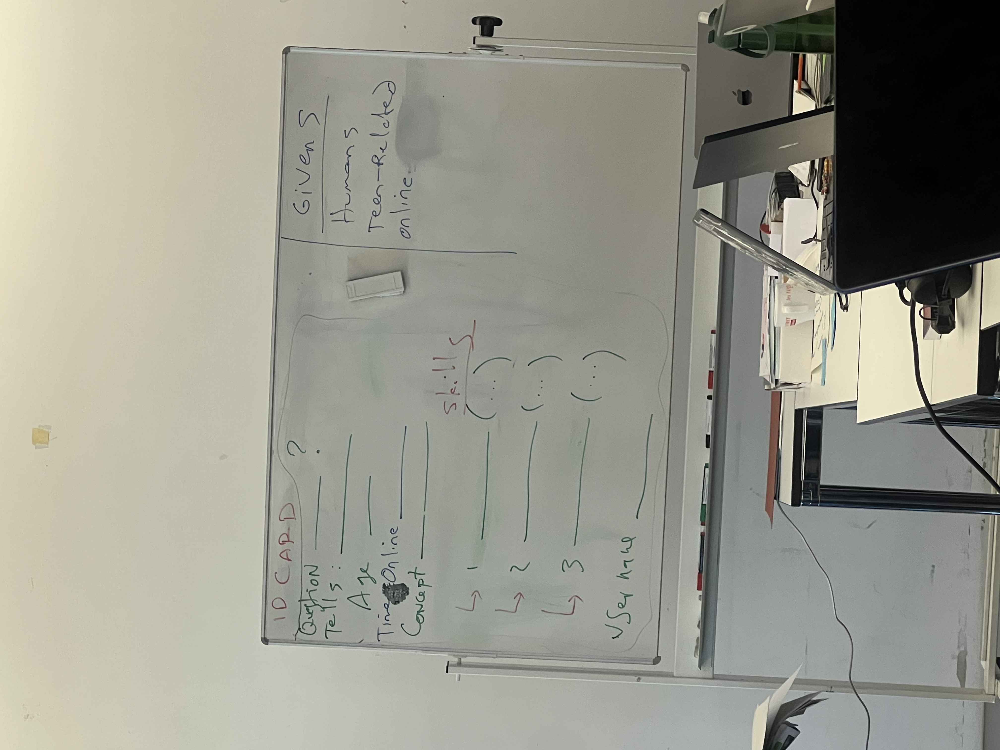

# 13.10.2026

ex 2 → creat character

ID CARD

Question: *If I’m not the funny one, not the smart one, not the popular one… then who am I?*

Tells: You don't have to become someone else to belong.

- Age: 14
- Time online: ~7 hours a day, mostly scrolling and watching other people live their lives
- Concept: A teen in an identity crisis. He doesn’t know who he is or where he fits in class, so he keeps trying on other people’s roles without ever feeling at home in any of them.

Skills:

1. Mimicry (copies the jokes, style and opinions of whoever he’s with, so he blends in anywhere but belongs nowhere)
2. Reading the room (spends so much time observing others that he notices every social shift before anyone else)
3. Shape-shifting online (switches aesthetics, profile pics and personas depending on the trend, with several accounts and no real “him”)

Username: Echo (he only reflects other people’s voices and has none of his own yet)

Les clichés, ou plus précisément les archétypes narratifs et les codes familiers, peuvent faciliter l'identification, la compréhension et l'immersion dans un jeu ou une histoire.

### Pourquoi ça fonctionne ?

1. Familiarité (Familiarity) : lorsqu'on reconnaît une situation, un personnage ou un scénario déjà rencontré, on dispose de repères pour le comprendre plus rapidement.

2. Schémas cognitifs (Schema Theory) : notre cerveau organise les connaissances en structures mentales. Quand une histoire reprend des codes connus, elle active ces structures et facilite l'assimilation de nouvelles informations.

3. Identification (Character Identification) : un personnage présentant des émotions, des motivations ou des expériences reconnaissables peut permettre au joueur de se projeter plus facilement dans l'histoire.

4. Réduction de la charge cognitive (Cognitive Load) : les conventions narratives connues demandent généralement moins d'effort pour être interprétées, ce qui peut laisser davantage d'attention à l'expérience et aux nouvelles mécaniques du jeu.

5. Immersion (Narrative Transportation) : une situation familière peut faciliter l'entrée dans un univers narratif, même fictif, à condition que celui-ci reste cohérent.

Mais il y a une distinction importante : un cliché n'est pas forcément un archétype. Un archétype est une structure reconnaissable, tandis qu'un cliché est une représentation devenue prévisible ou simplificatrice à force d'être répétée.

### La nuance : familiarité ≠ réalisme

Un élément familier n'est pas nécessairement plus réaliste. Il peut simplement être plus facile à reconnaître, à interpréter et à accepter dans l'univers de l'histoire.

Par exemple, dans un jeu fantastique, le personnage du héros rejeté par sa communauté est un archétype connu. Même si le monde est irréaliste, son besoin d'appartenance est compréhensible.

L'approche intéressante en game design serait donc :

Familiarité → compréhension → possibilité d'identification → immersion

Ce n'est pas une chaîne automatique, mais une hypothèse de conception cohérente avec la recherche.

### Sources scientifiques

- Kintsch & Greene (1978) — The role of culture-specific schemata in the comprehension and recall of stories. Montre que les structures narratives familières facilitent la compréhension et la mémorisation. (tandfonline.com)

- Felnhofer et al. (2023) — Character identification is predicted by narrative transportation, immersive tendencies, and interactivity. Étudie les facteurs favorisant l'identification aux personnages. (Springer Nature Link)

- Christy & Fox (2016) — Transportability and Presence as Predictors of Avatar Identification Within Narrative Video Games. Étudie l'identification aux avatars dans les jeux narratifs. (PubMed)

En résumé : utiliser des codes narratifs familiers peut être une bonne stratégie pour rendre un jeu plus accessible. Le plus intéressant est souvent de partir de quelque chose que le joueur connaît, puis d'introduire progressivement de l'inattendu.

Plot 

gb studio 

Tone meeting where you meet a text and u learn students take short stories from russian novels 19 century condense masterpieces that are the birth of the novel powerful

read 2 paragraphs what do you know and what do we don’t know 

diner cofee rock bamd music colorada 1975 julia game → smoker chill weed  20 s your age we are in a storie’s space 

Firewatch game 

scriptnotes premium

why is she starting to be mean to people and making chaos just because she feels appart? 

critics→ she could simply speak to people like I don’t understand, she would have done so many stuff with this spy headphone and she is just using it for making chaos it is quite frustrating to see her making chaos, and then when people hear her thoughts they just start to hate her even more we are just playing a role that is sad at first but at the end start to be hated by everone what is the purpose of it ?? I would have love to have the choice to do whatever I want with this headphone.
