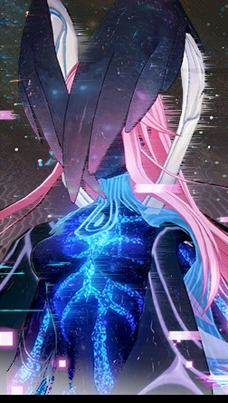

# First idea Echo

## The core concept

A world where AI makes everything, and where what’s real is worth more than gold.
Echo, a teenage hologram, neither boy nor girl, not quite real.
Their quest is to find the last human creations.
Their questions, Who am I ? What makes something human?
The ending, Echo is also a human creation, and the treasure was partly inside them all along.

## Where cyberbullying comes in

1. **Echo is bullied for what they are.**
In a world obsessed with being “certified real,” the other teens mock Echo “you’re not even real,” “fake,” “glitch.” They stick a label on Echo, just like on the objects. This is the identity-based bullying, being excluded for being different.

2. **Fake treasures = deepfakes.**
During the quest, Echo comes across objects with a fake “real” label. Among them is a doctored image of Echo that is being shared around. Learning to tell real from fake is the game mechanic.

3. **The ending becomes the prevention message.**
Echo was looking for a label to prove they are worth something. They discover that they already are a human creation, that no one has the power to certify who they are, and that the bullies’ labels don’t tell the truth. The treasure was inside them.

## In one sentence

Echo, a hologram everyone calls “fake,” sets out in search of what’s real, and discovers that their worth doesn’t depend on the label others stick on them.

The message isn’t preachy, and it speaks directly to a teenager who feels excluded, who needed to understand that what she was going through wasn’t normal.

## Visual references

### The world
AI makes everything images, voices, music, memories, even the feeling of sun on your skin. The rarest things have a small label, *real, made by a human*. They are worth more than gold.

.jpeg)

.jpeg)

### Echo
A teenage hologram, made by AI, not a man and not a woman. You can see it is not fully real translucent, half-body, half-flower, half-machine.

.jpeg)

.jpeg)

.jpeg)

.png)

.png)

