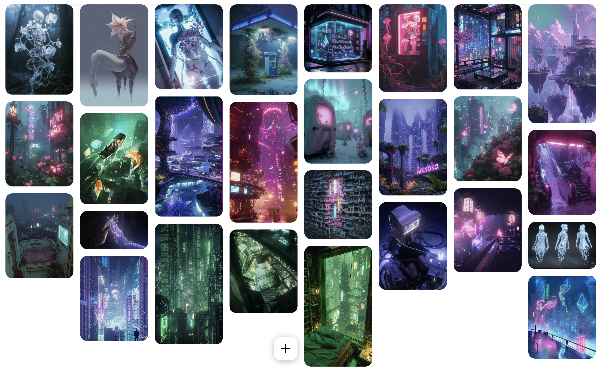

# Echo

Echo, a hologram everyone calls “fake,” sets out in search of what’s real, and discovers that their worth doesn’t depend on the label others stick on them.

## Pitch

In a world where AI makes everything (images, voices, music, even the feeling of sun on your skin), the only things that still matter are those labelled “real, made by a human,” worth more than gold. Echo, a teenage hologram who is neither boy nor girl and not quite real, searches for the last human creations while the other teens mock them as “fake” and stick a label on them, just like on the objects. In the end Echo discovers that they are themselves a human creation, that nobody has the power to certify who they are, and that the treasure was inside them all along.

The message isn’t preachy, and it speaks directly to a teenager who feels excluded, who needed to understand that what was going on wasn’t normal.

## Where cyberbullying comes in

1. **Echo is bullied for what they are.**
In a world obsessed with being “certified real,” the other teens mock Echo “you’re not even real,” “fake,” “glitch.” They stick a label on Echo, just like on the objects. This is the identity-based bullying, being excluded for being different.

2. **Fake treasures = deepfakes.**
During the quest, Echo comes across objects with a fake “real” label. Among them is a doctored image of Echo that is being shared around. Learning to tell real from fake is the game mechanic.

3. **The ending becomes the prevention message.**
Echo was looking for a label to prove they are worth something. They discover that they already are a human creation, that no one has the power to certify who they are, and that the bullies’ labels don’t tell the truth. The treasure was inside them.

## Moodboard

### The world
AI makes everything images, voices, music, memories, even the feeling of sun on your skin. The rarest things have a small label, *real, made by a human*. They are worth more than gold.

### Echo
A teenage hologram, made by AI, not a man and not a woman. You can see it is not fully real translucent, half-body, half-flower, half-machine.

## Influences

- Solarpunk
- GTA
- *The Warriors* (1979)
- *Firewatch*

## Presentation

At 2026-10-19-16:00 we will open up each github process folder and go through each first idea.

- 5 minutes (or less) per idea
- You can put text, image(s), whatever
